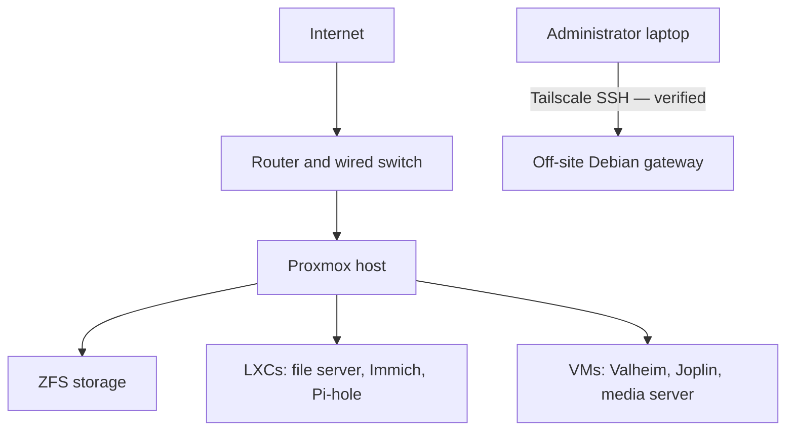

# HomeLab Overview

## Purpose

This homelab is a personal environment used to develop hands-on experience with Linux administration, virtualization, networking, storage, self-hosted services, troubleshooting, and infrastructure management.

The lab is built on a dedicated Dell PowerEdge R510 Server from a past FB marketplace purchase and is running Proxmox VE. Virtual machines and Linux containers are used to separate services while ZFS provides centralized storage for applications and network file storage.

---

## Current Environment

### Virtualization
- Proxmox VE
- Linux Containers (LXC)
- Virtual Machines

### Storage
- ZFS storage pool
- RAIDZ2 disk configuration
- Separate datasets for different services

### Current Services
- SMB File Server
- Immich photo and video management
- Valheim dedicated Game Server (GameServer1)
- Joplin Server for self-hosted note synchronization
- Pi-hole for network-wide DNS filtering and local DNS
- Media server VM running Jellyfin, qBittorrent, Radarr, Sonarr, Prowlarr, and Seerr
- Separate off-site Debian gateway for private Tailscale/SSH administration

### In Progress
- Valheim external connection troubleshooting and automatic startup
- Joplin synchronization verification and secure remote access
- Joplin and PostgreSQL backups
- Homelab documentation updates
- Media request-approval and import workflow verification
- Reliability testing for Pi-hole and SMB/LXC network recovery
- Storage redundancy restoration and backup planning

### Planned
- Network monitoring
- Improved backup and recovery procedures
- Additional self-hosted applications
- Network configuration
- Additional Linux testing environments
- A separate WireGuard game-traffic tunnel through the off-site gateway
- VPN isolation for qBittorrent traffic

---

## High-Level Architecture

The off-site gateway is **independent physical hardware**. A future WireGuard game tunnel to the home lab is planned, not represented as a working connection in this verified-state diagram.

---

## Goals

The main goals of this project are to:

- Gain practical experience managing Linux servers.
- Learn virtualization and container administration.
- Develop networking and troubleshooting skills.
- Learn how to deploy and maintain self-hosted applications.
- Gain experience with ZFS storage and data management.
- Build reliable backup and recovery procedures.
- Document infrastructure changes and troubleshooting processes.
- Create a portfolio demonstrating practical IT and infrastructure experience.

---

## Documentation

Detailed documentation for the environment is separated into the following:

- Hardware
- Network Architecture
- Proxmox
- ZFS Storage
- File Server
- Immich
- Joplin
- Monitoring
- Backup & Recovery
- Troubleshooting Logs
- Future Improvements & Goals
- GameServer1
- Pi-hole
- MediaServer1
- Off-Site Gateway
- Daily Logs

---

## Current Status

The homelab is actively being developed and expanded.

Core virtualization, ZFS storage, network file storage, and Immich services are currently operational.

GameServer1 has been deployed and the Valheim server has successfully started. External connections are still being troubleshooted due to ISP CGNAT, PlayFab connection issues, and latency differences between relay services.

Joplin Server has also been deployed in a dedicated Debian VM using Docker Compose and PostgreSQL. Laptop and desktop synchronization has been configured with end-to-end encryption. Some synchronization and note rendering problems still need further verification.

Pi-hole has been deployed in CT104 and is configured through the Eero Pro 7 for DNS filtering. Local DNS records have also been added to access Homelab services using hostnames. Ad blocking was successfully tested on the Linux desktop, and Joplin was updated to work with its local hostname. Additional device testing, backups, and DNS recovery testing are still needed.

In October, the file-server and Pi-hole containers experienced DHCPv6-related startup/network failures. Changing the LXC IPv6 setting from DHCP to manual restored IPv4 and DNS service during testing. Longer-duration recovery validation is still needed.

The media-server VM is operational with Docker Compose and ZFS-backed media storage presented over VirtioFS. A test download, import, and Jellyfin playback were verified. Full Seerr request automation and qBittorrent VPN isolation remain unverified.

An independent Debian gateway has been hardened for private administration, with Tailscale connectivity, key-only SSH, firewall/rollback testing, and recovery tests completed. It was deployed to a trusted off-site network and remained reachable after reboot. The proposed WireGuard game path, public forwarding, and off-site backup workflow are **not** yet implemented.

The ZFS RAIDZ2 pool is **DEGRADED** after a deliberate drive removal. Historic capacity figures elsewhere in this repository are snapshots, not current health evidence; the pool requires renewed verification and a redundancy plan.

Additional monitoring, backup procedures, and network improvements are being implemented as the environment grows. These pages document the last verified state through **October 27, 2026**; October 28 work remains in progress.
