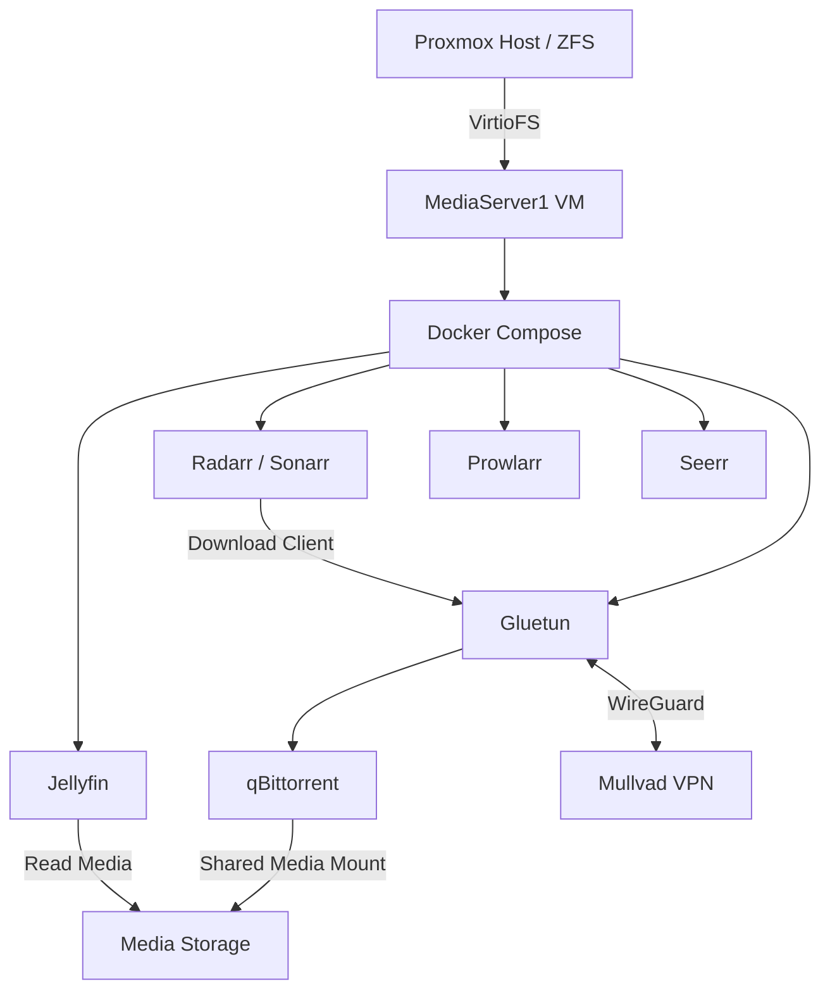
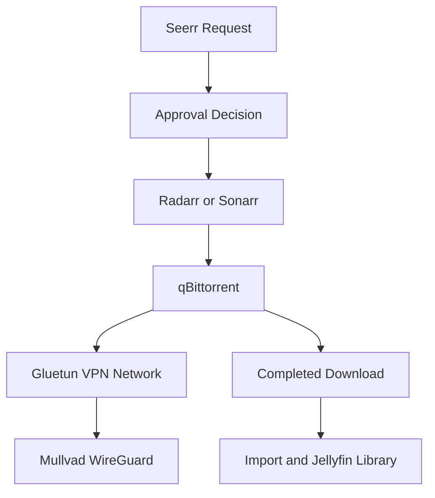

# MediaServer1

## Overview

MediaServer1 is a dedicated Debian virtual machine that hosts the homelab's household media software. It separates media applications from the file-server LXC and other workloads while using centrally managed ZFS storage.

The deployed stack includes **Jellyfin, qBittorrent, Radarr, Sonarr, Prowlarr, Seerr, and Gluetun**.

Its purpose is to support household media streaming, organization, downloading, and a future request/approval workflow.

Mullvad VPN has been integrated through Gluetun to protect qBittorrent traffic without routing the other media services through the VPN.

> **Publication scope:** This page contains sanitized examples. Actual addresses, hostnames, credentials, private share paths, request accounts, and VPN keys are intentionally excluded. Last updated and verified October 29, 2026.

---

## Deployment Status

| Component | Last Documented State |
| --- | --- |
| Debian media VM | Deployed and operational |
| Docker / Docker Compose | Deployed |
| VirtioFS media mount | Mounted persistently; write access tested |
| Jellyfin | Library scan and playback tested |
| qBittorrent | Operational through Mullvad VPN |
| Mullvad VPN | Connected and verified |
| Gluetun | Deployed, healthy, and tested |
| VPN kill switch | Firewall and failure recovery tested |
| Radarr / Sonarr | Download-client connectivity verified after VPN integration |
| Prowlarr | App/indexer tests reported working |
| Seerr | Running; full request/approval automation not conclusively validated |
| Torrent IP verification | VPN-hosted IP detected |
| Automatic startup | Compose startup ordering tested |
| VM reboot recovery | All seven containers restarted successfully |
| Monitoring and restore-tested backups | **Not established** |
| Household Jellyfin account | Planned; not yet verified |
| Public remote access | Not configured |

The media stack is operational, and the VPN integration has passed connectivity, firewall, recovery, and reboot testing.

Passing individual application tests does not prove that the full media request and import workflow works unattended.

---

## Virtual Machine Information

| Setting | Value |
| --- | --- |
| Platform | Proxmox VE |
| VM ID | 105 |
| Guest type | Virtual machine |
| Operating system | Debian 13 |
| Guest name | MediaServer1 (documentation alias) |
| Network | Proxmox Linux bridge (`vmbr0`) |
| LAN address | `x.x.x.x` (sanitized) |
| Address management | Reserved/consistent LAN assignment |
| Workload runtime | Docker with Docker Compose |
| Persistent media | Host ZFS dataset, passed into guest via VirtioFS |
| VPN provider | Mullvad |
| VPN protocol | WireGuard |
| VPN management | Gluetun Docker container |

The exact current vCPU and RAM configuration were not independently re-audited for this update.

The media stack is managed through Docker Compose under a dedicated application directory.

Media content is mounted at `/mnt/media` inside the Debian guest.

---

## Architecture



The media storage path is:

**Proxmox ZFS → VirtioFS → Debian VM → Docker containers**

This is not a CIFS/SMB mount inside the media VM.

The separate Samba file server serves other clients on the local network.

### VPN Architecture

The VPN connection is isolated to qBittorrent.

Traffic flow:

Internet
|
Mullvad VPN
|
WireGuard Tunnel
|
Gluetun Firewall
|
qBittorrent

Gluetun manages the VPN tunnel and firewall.

Jellyfin, Radarr, Sonarr, Prowlarr, and Seerr remain on the normal Docker network.

---

## Storage Design

The Proxmox host provides a ZFS-backed media dataset. Its exact host path and share identifier are omitted here.

The guest mounts it persistently at `/mnt/media` through `/etc/fstab`.

The intended directory layout is:

```text
/mnt/media/
├── downloads/
│   ├── incomplete/
│   └── complete/
├── movies/
└── tv/
```

Containers use a common internal `/data` mapping where needed so downloads and imports refer to the same underlying files.

Incorrect or inconsistent bind-mount paths can prevent Radarr/Sonarr from importing completed downloads.

File ownership was aligned with the media service identity (UID/GID mapping tested around `1000:1000`), and write tests succeeded.

Do not apply recursive ownership changes to unrelated datasets without checking the intended permissions.

**Storage risk:** The underlying ZFS RAIDZ2 pool was previously reported `DEGRADED` following an intentional disk removal.

Full redundancy restoration and an independently verified backup strategy remain unfinished.

---

## Applications

### Jellyfin

Jellyfin serves organized media libraries to household devices.

Current status:

- Docker container deployed and running.
- Movie and television libraries configured.
- Library scanning tested.
- Local playback tested successfully.
- Container reported healthy after the MediaServer1 reboot.
- Media libraries use read-only Docker mounts.

Jellyfin is not routed through Mullvad.

A separate non-administrator household viewing account is planned.

Individual accounts for additional family members may be added later.

Long-term transcoding performance and every client type have not been comprehensively tested.

### qBittorrent

qBittorrent handles downloads for the media workflow.

Initial testing included a Debian installation image and confirmed the configured download destination.

Completed-download seeding behavior was configured to stop.

On October 29, qBittorrent was moved behind Gluetun and Mullvad VPN.

Current configuration:

- Uses Gluetun's Docker network namespace.
- Routes outbound internet traffic through Mullvad.
- Does not publish independent Docker ports.
- WebUI access is provided through Gluetun.
- Uses the shared media storage mount.
- Bound to the `tun0` network interface.
- Uses the `unless-stopped` restart policy.
- Waits for Gluetun to become healthy during Compose-managed startup.

The public IP used by qBittorrent was verified through Mullvad's official connection checker.

An independent torrent IP detection test also reported a VPN-hosted IP.

Stopping completed seeding is a separate client behavior setting and should not be confused with VPN protection.

### Gluetun

Gluetun is a VPN management container used to connect qBittorrent to Mullvad.

It manages:

- WireGuard tunnel establishment
- Firewall rules
- VPN health checks
- Automatic VPN reconnection
- VPN network namespace
- Outbound traffic isolation

Gluetun has access to `/dev/net/tun` and uses the NET_ADMIN capability.

Its VPN configuration is stored separately from Docker Compose.

The container uses the `unless-stopped` restart policy.

Gluetun's health checks successfully detected and recovered from a simulated WireGuard failure.

### Radarr and Sonarr

Radarr organizes movie media, while Sonarr handles television media.

Both applications remain on the normal Docker network.

After qBittorrent was moved behind Gluetun, the download-client hostname was changed.

Current download-client configuration:

| Setting | Value |
| --- | --- |
| Host | `gluetun` |
| Port | `8080` |
| Authentication | Existing qBittorrent credentials |
| Connection | Internal Docker network |

Both Radarr and Sonarr passed connection tests after VPN integration.

The tests were repeated after VPN failure recovery and passed again.

End-to-end unattended download, import, and playback automation still requires a dedicated verification.

### Prowlarr

Prowlarr manages indexer integrations for Radarr and Sonarr.

App tests and an indexer-save operation succeeded during initial setup.

Prowlarr remains on the normal Docker network and does not require Mullvad routing.

Not every downstream synchronization path was individually documented as verified.

### Seerr

Seerr provides a request interface for household movies and television.

The intended approval policy is:

- Owner requests can be approved automatically.
- Other household requests require approval.
- Approved requests are passed to Radarr or Sonarr.

The complete request → approval → download → import → playback workflow has not been conclusively retested after VPN integration.

Seerr was confirmed healthy after the MediaServer1 reboot.

---

## Mullvad VPN Integration

**Deployment Date:** October 29, 2026
**Status:** Operational

### VPN Configuration

| Setting | Value |
| --- | --- |
| Provider | Mullvad |
| Protocol | WireGuard |
| Server Region | Houston, Texas |
| VPN Management | Gluetun |
| Network Interface | `tun0` |
| Docker Network | `media-stack_default` |
| Protected Application | qBittorrent |
| WebUI Port | `8080` |
| Firewall | Enabled |
| Automatic Reconnection | Enabled |
| Torrent Port Forwarding | Not available through Mullvad |

The WireGuard configuration is stored locally with root ownership and restricted file permissions.

Private keys, account numbers, and other credentials are not included in public documentation.

### Docker Compose Integration

Gluetun was added as a seventh service in the existing Compose stack.

qBittorrent uses:

```yaml
network_mode: "service:gluetun"
```

This makes qBittorrent share Gluetun's network namespace.

qBittorrent no longer publishes its own Docker ports.

The WebUI port is published through Gluetun instead.

Example sanitized local access:

`http://x.x.x.x:8080`

Internal DNS example:

`http://mediaserver1.example.internal:8080`

Gluetun allows incoming WebUI traffic through its firewall using port 8080.

### Automatic Startup

The following dependency was added to qBittorrent:

```yaml
depends_on:
  gluetun:
    condition: service_healthy
    restart: true
```

This causes qBittorrent to wait for Gluetun to report healthy during Compose-managed startups.

The `restart: true` dependency applies to explicit Compose operations. It does not guarantee automatic dependency-based restarts after every unexpected container failure.

Both Gluetun and qBittorrent also use:

```yaml
restart: unless-stopped
```

A controlled startup test confirmed Gluetun became healthy before qBittorrent started.

A full VM reboot also confirmed both containers restarted automatically and regained connectivity.

### Firewall and Kill Switch

Gluetun's outgoing firewall was inspected using iptables.

The default OUTPUT policy was:

```text
-P OUTPUT DROP
```

Allowed outgoing traffic was restricted to:

- Local loopback traffic
- Established and related connections
- Required Docker network communication
- The configured WireGuard endpoint
- Traffic using the VPN tunnel interface

There was no unrestricted outgoing internet rule through the normal Docker interface.

qBittorrent was also configured to bind directly to `tun0`.

This provides an additional layer of protection if routing rules change unexpectedly.

### VPN Failure Testing

Two failure scenarios were tested.

**Test 1 — Gluetun Container Stopped**

- Stopped the Gluetun container.
- Attempted external DNS resolution from qBittorrent.
- DNS resolution failed.
- Attempted a direct-IP HTTPS connection.
- The connection failed.
- No successful unprotected internet connection was observed.

**Test 2 — WireGuard Interface Disabled**

- Disabled the `tun0` interface while Gluetun remained running.
- Gluetun detected the failed health check.
- Firewall rules blocked outbound DNS requests during the interruption.
- Gluetun automatically restarted WireGuard.
- The Mullvad connection returned successfully.
- qBittorrent connectivity through Mullvad was verified afterward.

The second test demonstrated automatic recovery and firewall enforcement, although a direct qBittorrent traffic attempt was not captured during the brief outage.

### Torrent IP Verification

An external torrent IP test was performed.

The initial IPLeak tracker timed out, although its HTTPS endpoint was reachable from the qBittorrent container.

A second torrent IP detection service successfully reported a VPN-hosted address.

The detected torrent IP was consistent with the Mullvad connection rather than the residential ISP address.

No residential IP exposure was observed during the completed tests.

### Reboot Recovery

MediaServer1 was rebooted after the VPN configuration was completed.

Following the reboot:

- All seven Docker containers restarted automatically.
- Gluetun reported healthy.
- qBittorrent was running.
- Jellyfin reported healthy.
- Seerr reported healthy.
- Radarr, Sonarr, and Prowlarr were running.
- qBittorrent's public IP was verified through Mullvad.

No manual container restart was required.

This confirmed successful recovery during the tested VM reboot.

It does not guarantee that every future Docker or host failure will recover in the same way.

---

## Intended Media Workflow



The VPN integration is now complete.

The full media request and import workflow still needs final end-to-end testing.

Prowlarr supports indexer management for the Radarr/Sonarr applications.

---

## Network and Access

### Local Network

- MediaServer1 uses the Proxmox bridge `vmbr0`.
- Application web interfaces are accessible through the trusted LAN.
- Local DNS records provide easier access to services.
- qBittorrent's WebUI is published through Gluetun.
- Administrative applications are not intended for public exposure.

### VPN Network

Mullvad is used specifically for qBittorrent traffic.

Gluetun keeps this network isolated from the other media containers.

This VPN does not provide remote access to Jellyfin.

### Remote Access

The home ISP uses CGNAT.

Direct public inbound access to MediaServer1 has not been configured.

Tailscale has been considered for private remote access, but has not yet been installed and verified on MediaServer1.

The separate off-site gateway already supports private Tailscale administration for the gateway itself.

### Future Public Access

A future TCloud family website is planned.

The intended design includes:

- A welcome/login page
- A family dashboard
- Jellyfin access for viewing media
- Seerr access for requesting media
- Separate administrator access

The preferred experience does not require household users to install Tailscale.

TCloud-gate may eventually provide a public entry point through an off-site network and encrypted tunnel.

The off-site network's public IPv4 reachability and router forwarding capabilities still need verification.

No public media access or gateway forwarding was deployed during this update.

---

## Service Administration

These are generic read-only checks. Run them from the appropriate system after verifying the local Compose project directory.

```bash
# From the Debian media VM
docker compose ps
```

```bash
# Review application logs
docker compose logs --tail=100
```

```bash
# Check the media mount
findmnt /mnt/media
```

```bash
# Check available media storage
df -h /mnt/media
```

```bash
# From the Proxmox host
qm list
```

### VPN Administration

Check VPN container health:

```bash
docker inspect gluetun --format '{{.State.Health.Status}}'
```

Check Gluetun logs:

```bash
docker logs --tail 50 gluetun
```

Verify the VPN exit IP from inside qBittorrent:

```bash
docker exec qbittorrent curl -fsS https://am.i.mullvad.net/json
```

The expected result includes:

`"mullvad_exit_ip":true`

The actual public VPN address can change depending on the connected server.

Changing Compose files, dataset ownership, network settings, or container images should be preceded by a backup and reviewed rollback plan.

Do not commit VPN credentials or a real WireGuard configuration to GitHub.

---

## Testing Performed

| Test | Result | Limitation |
| --- | --- | --- |
| VirtioFS mount and persistent guest path | Passed | Repeated host-failure recovery not documented |
| UID/GID file access and write operations | Passed | Other identities not exhaustively tested |
| Sample download in qBittorrent | Passed | Initial test predates VPN |
| Mullvad WireGuard connection | Passed | Requires active subscription |
| Gluetun firewall rules | Verified | Must remain correctly configured |
| qBittorrent network isolation | Passed | Future changes require revalidation |
| VPN exit IP verification | Passed | Exit IP may change |
| Torrent IP detection | Passed | No guarantee against every possible leak |
| VPN container-stop test | Passed | Tested one failure condition |
| WireGuard interface failure | Recovery verified | Direct torrent traffic not captured during outage |
| Radarr/Sonarr download-client tests | Passed | Full media request workflow remains open |
| Prowlarr indexer/app tests | Passed | Full downstream sync not individually verified |
| Jellyfin library scan/playback | Passed | Broad client/transcoding tests pending |
| Seerr approval policy and automation | Not fully verified | Requires dedicated tests |
| Compose startup dependency | Passed | Applies to Compose-managed startup |
| Full MediaServer1 reboot | Passed | Proxmox host reboot not tested |
| Automated backups and restore | Not established | Requires separate project |

---

## Troubleshooting Notes

### Guest Media Path Is Missing

Check that the Proxmox VirtioFS device is attached, the guest's configured mount is active, and the dataset is available on the host.

Avoid substituting an SMB path without reviewing permissions and application mappings.

### Download Completed but Import Did Not

Confirm consistent paths between qBittorrent and Radarr/Sonarr, service permissions, completed-download handling, and relevant application logs.

A successful download alone does not prove an import was attempted.

### Jellyfin Library Is Empty

Check the shared mount, library paths, access permissions, and Jellyfin scan status before changing ownership or restarting unrelated services.

### Radarr or Sonarr Cannot Connect to qBittorrent

After moving qBittorrent behind Gluetun, the old `qbittorrent` Docker hostname was no longer valid for the download-client connection.

The correct internal hostname is now:

`gluetun`

The WebUI port remains:

`8080`

Both applications passed their connection tests using this configuration.

### VPN Is Connected but qBittorrent Has No Internet

Check:

- Gluetun container status
- Gluetun health checks
- WireGuard connection logs
- qBittorrent's `tun0` binding
- Docker networking
- Mullvad account status

Do not disable the firewall or change qBittorrent to an unrestricted network interface as a troubleshooting shortcut.

### VPN Container Restart Breaks qBittorrent Connectivity

Because qBittorrent shares Gluetun's network namespace, recreating Gluetun can leave qBittorrent attached to an old namespace.

During testing, qBittorrent was recreated through Docker Compose after Gluetun was restored.

This returned qBittorrent to the active VPN network.

A future recovery procedure should account for this dependency.

### Torrent IP Checker Times Out

The first torrent IP detection service timed out when contacting its tracker.

The HTTPS endpoint itself was reachable.

An independent torrent IP checker worked and reported a VPN-hosted address.

A failed tracker test alone does not prove the VPN has disconnected.

### Desktop Tailscale Startup Failure

Tailscale was installed on the CachyOS desktop but failed to start because the running kernel did not match the installed kernel modules.

This is a separate client issue and does not affect Mullvad running on MediaServer1.

A desktop reboot and follow-up verification are pending.

---

## Backup and Recovery

Important recoverable items include:

- Docker Compose configuration
- Application configuration and databases
- VPN configuration and recovery information stored securely outside GitHub
- Jellyfin library metadata
- Radarr/Sonarr application state
- Seerr account and request information
- qBittorrent configuration
- Media organization and irreplaceable content
- Host ZFS dataset and VirtioFS integration
- VM configuration and networking assumptions

A backup of the existing Compose configuration was made before the VPN integration.

This was a configuration safety backup, not a complete media-server backup.

A complete restoration process should verify application metadata, network connectivity, media access, and actual playback.

No automated, restore-tested off-site backup process has been confirmed for MediaServer1.

---

## Current Limitations

- Full Seerr request/approval and automatic media import workflow not conclusively tested.
- Household Jellyfin viewing account not yet verified.
- No comprehensive media-service monitoring or alerting.
- No confirmed automated, restore-tested backup of application metadata and media storage.
- Underlying ZFS pool previously reported `DEGRADED`.
- No verified Tailscale remote access to MediaServer1.
- No public family portal deployed.
- Mullvad does not support port forwarding.
- VPN subscription and routine maintenance are required.
- Compose dependency behavior does not guarantee every automatic restart ordering.
- Exact media VM resource allocation requires a fresh audit.

---

## Planned Improvements

### Media Services

- Create and test a non-administrator household Jellyfin account.
- Verify Seerr request approvals.
- Test automatic downloads, imports, and Jellyfin playback end to end.
- Review user permissions before adding additional household accounts.

### Security

- Maintain Mullvad VPN subscription.
- Periodically verify Gluetun health and qBittorrent's VPN IP.
- Keep qBittorrent bound to `tun0`.
- Review Docker image updates.
- Add VPN failure notifications and monitoring.

### Remote Access

- Configure Tailscale on MediaServer1 for private remote access.
- Continue designing the TCloud family media portal.
- Investigate using TCloud-gate for selected public services.
- Use HTTPS and authentication before exposing family-facing applications.
- Keep administrative services private.

### Storage and Reliability

- Add service and storage monitoring.
- Document update and rollback procedures for the Compose stack.
- Establish a backup and restoration procedure for application metadata.
- Restore and verify ZFS redundancy when appropriate.
- Retest storage and service recovery after a Proxmox host restart.

---

## Related Documentation

- `02 - Network Architecture.md`
- `03 - Proxmox.md`
- `04 - ZFS Storage.md`
- `08 - Monitoring.md`
- `09 - Backup & Recovery.md`
- `10 - Troubleshooting Logs.md`
- `11 - Future Improvements/Goals.md`
- `15 - Off-Site Gateway.md`
- `Daily Logs/2026-10-29.md`
