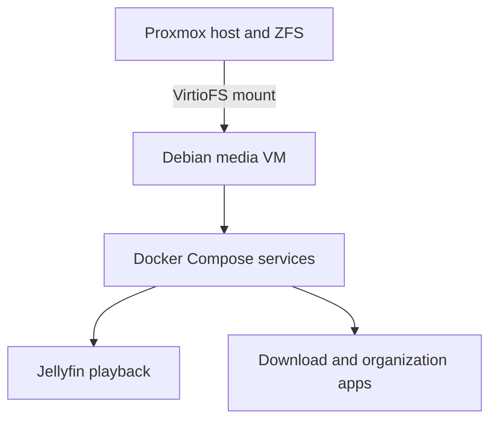
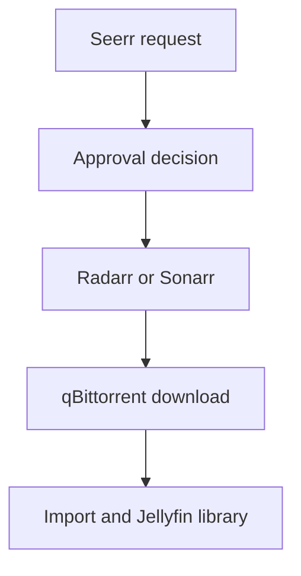

# MediaServer1

## Overview

MediaServer1 is a dedicated Debian virtual machine that hosts the homelab's household media software. It separates media applications from the file-server LXC and other workloads while using centrally managed ZFS storage.

The deployed stack includes **Jellyfin, qBittorrent, Radarr, Sonarr, Prowlarr, and Seerr**. Its purpose is to support local streaming, media organization, and an eventual request/approval workflow.

> **Publication scope:** This page contains sanitized examples. Actual addresses, hostnames, credentials, media titles, private share paths, request accounts, and VPN keys are intentionally excluded. The last documented verification was through October 27, 2026.

---

## Deployment Status

| Component | Last Documented State |
| --- | --- |
| Debian media VM | Deployed |
| Docker / Docker Compose | Deployed |
| VirtioFS media mount | Mounted persistently; write access tested |
| Jellyfin | Library scan and playback tested |
| qBittorrent | Test download completed; seeding-stop behavior configured |
| Radarr / Sonarr | Download-client connectivity tests reported working |
| Prowlarr | App/indexer tests reported working; one indexer saved |
| Seerr | Included in stack; full request/approval automation not conclusively validated |
| qBittorrent VPN isolation | **Not verified/implemented** |
| Monitoring and restore-tested backups | **Not established** |

Passing an individual app test does not prove that the full automation chain works unattended.

---

## Virtual Machine Information

| Setting | Value |
| --- | --- |
| Platform | Proxmox VE |
| Guest type | Virtual machine |
| Operating system | Debian 13 |
| Guest name | MediaServer1 (documentation alias) |
| Network | Proxmox Linux bridge (`vmbr0`) |
| LAN address | `x.x.x.x` (sanitized) |
| Address management | Reserved/consistent LAN assignment |
| Workload runtime | Docker with Docker Compose |
| Persistent media | Host ZFS dataset, passed into guest via VirtioFS |

The exact current vCPU and RAM configuration were not independently re-audited for this update and should not be guessed from other VMs.

The media stack was set up under an application directory such as `/opt/<media-stack>` (placeholder in this public version). Media content is mounted at `/mnt/media` in the guest.

---

## Architecture



The data path is **local Proxmox host storage → VirtioFS → VM filesystem → Docker containers**. It is not a CIFS/SMB mount inside the media VM. The separate Samba file server serves other clients on the local network.

---

## Storage Design

The Proxmox host provides a ZFS-backed media dataset; its exact host path and share identifier are omitted here. The guest mounts it persistently at `/mnt/media` through `/etc/fstab`.

The intended directory layout is:

```text
/mnt/media/
├── downloads/
│   ├── incomplete/
│   └── complete/
├── movies/
└── tv/
```

Containers use a common internal `/data` mapping so download and import paths refer to the same underlying files. Incorrect or inconsistent bind-mount paths can prevent Radarr/Sonarr from importing completed downloads.

File ownership was aligned with the media service identity (UID/GID mapping tested around `1000:1000`) and write tests succeeded. Do not copy a recursive ownership command from public examples onto an unrelated production dataset; validate the intended users and permissions first.

**Storage risk:** The underlying ZFS RAIDZ2 pool was reported `DEGRADED` following an intentional disk removal. The media dataset should not be described as fully redundant or independently backed up without a fresh verification.

---

## Applications

### Jellyfin

Jellyfin serves the organized media libraries to supported clients. A library scan and playback test succeeded during initial setup. Long-term transcoding performance and every client type have not been comprehensively tested.

### qBittorrent

qBittorrent provides a download client for the workflow. A Debian installation image was used as a test download, and the configured destination under the shared media mount was observed. Completed-download seeding was configured to stop.

**Privacy/security limitation:** No tested VPN-bound qBittorrent setup existed in the recorded session. Stopping seeding does not anonymize traffic. Do not describe qBittorrent as VPN-protected until a kill-switch/fail-closed test is successful.

### Radarr and Sonarr

Radarr organizes movie media; Sonarr performs a similar role for television. Connectivity checks with qBittorrent were reported successful. End-to-end unattended selection, acquisition, import, and client presentation still require validation.

### Prowlarr

Prowlarr manages indexer integrations for the media applications. App tests and an indexer-save operation succeeded; not every downstream synchronization path was individually documented as verified.

### Seerr

Seerr is intended to provide a request interface for household media. The desired approval policy is to allow the owner's own requests and require approval for other users. The complete request → approval → download → import → playback chain was **not** conclusively tested in the available record.

---

## Intended Media Workflow



This diagram shows the **intended** integrated flow. It is not a claim that all branches, permissions, indexer mappings, and automatic import conditions passed end-to-end testing. Prowlarr supports indexer management for the *arr applications.

---

## Network and Access

- The VM is attached to the trusted LAN using the Proxmox bridge.
- Application web interfaces are intended for authorized local users or a separately verified secure-access path.
- The home ISP uses CGNAT; no direct inbound public application exposure was verified here.
- The separate off-site gateway provides Tailscale **SSH administration for the gateway itself**. That does not automatically expose the media stack through Tailscale.
- A dedicated VPN for qBittorrent is a future task; do not confuse it with the Tailscale management network or planned WireGuard game tunnel.

No real URLs, ports mapped to private hosts, passwords, tokens, or client media lists are stored in this public page.

---

## Service Administration

These are generic read-only checks; run them in the appropriate context after verifying the local application directory:

```bash
# From the Debian media VM's Compose project directory
docker compose ps
docker compose logs --tail=100

# Confirm the guest can see the persistent media mount
findmnt /mnt/media
df -h /mnt/media

# From the Proxmox host
qm list
```

Changing Compose files, dataset ownership, download paths, or container images should be preceded by a known-good backup and a reviewed rollback plan. Do not assume media application databases are included in a VM-only snapshot if they live on separate mounts.

---

## Testing Performed

| Test | Result | Limitation |
| --- | --- | --- |
| VirtioFS mount and persistent guest path | Passed | Repeated host-failure recovery not documented |
| UID/GID file access and write operations | Passed | Other access identities not exhaustively tested |
| Sample download in qBittorrent | Passed | Not a VPN isolation test |
| Radarr/Sonarr download client tests | Reported passed | End-to-end request flow still open |
| Prowlarr indexer/app test | Reported passed | Full downstream sync not individually verified |
| Jellyfin library scan/playback | Passed | Broad client/transcoding tests pending |
| Seerr approval policy and automation | Not fully verified | Requires dedicated test cases |

---

## Troubleshooting Notes

### Guest Media Path Is Missing

Check that the Proxmox VirtioFS device is attached, the guest's configured mount is active, and the dataset is available on the host. Avoid substituting an SMB path without reviewing permissions and application mappings.

### Download Completed but Import Did Not

Confirm consistent paths between qBittorrent and Radarr/Sonarr, service permissions, completed-download handling, and relevant app logs. A successful download alone does not prove an import was attempted.

### Jellyfin Library Is Empty

Check the shared mount, library paths, access permissions, and Jellyfin scan status before changing ownership or restarting unrelated services.

---

## Backup and Recovery

Important recoverable items include:

- Docker Compose configuration (without secrets in GitHub)
- Application metadata/databases and configuration
- Library organization and any irreplaceable media
- Host dataset and VirtioFS integration documentation
- VM configuration and network assumptions

A complete restoration should separately verify application metadata, media access, and actual playback. No automated off-site backup/restore process was verified as completed for this stack.

---

## Current Limitations

- Full Seerr request/approval and automatic media import workflow not conclusively tested.
- No verified VPN isolation or fail-closed protection for qBittorrent.
- No comprehensive media service monitoring or alerting.
- No confirmed automated, restore-tested backup of application metadata and the media dataset.
- Underlying ZFS pool reported `DEGRADED` at last review.
- Exact media VM resource allocation and later configuration changes require a fresh audit.

---

## Planned Improvements

- Verify request policy, indexers, downloads, imports, and Jellyfin playback end to end.
- Implement and test VPN-bound qBittorrent with fail-closed behavior.
- Add service and storage monitoring.
- Document update/rollback processes for the Compose stack.
- Establish a backup and restoration procedure, including application metadata.
- Retest storage and service recovery after Proxmox restart.

See also `03 - Proxmox.md`, `04 - ZFS Storage.md`, `08 - Monitoring.md`, and `09 - Backup & Recovery.md`.
