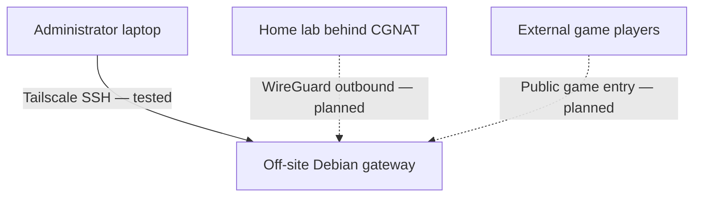

# Off-Site Gateway

## Overview

The off-site gateway is an independent Debian mini PC deployed to a trusted network separate from the primary homelab. Its **implemented purpose** is private remote administration over Tailscale and ordinary SSH. Its **planned purpose** is to provide a future public-game ingress point connected to the CGNAT home network by a separate WireGuard tunnel.

The hardware is **not a Proxmox VM** and the two remote-access use cases must not be conflated.

> **Public documentation:** Hostname, usernames, IP addresses, physical site, keys, tailnet identity, router configuration, and recovery contacts are generalized or omitted. State below reflects verified work through October 27, 2026.

---

## Project Objectives

1. Keep an independent, remotely reachable Linux system for secure administration.
2. Use private Tailscale connectivity without exposing SSH directly to the Internet.
3. Recover automatically from routine reboots, Ethernet interruptions, and AC power restoration.
4. Eventually support a **separate** WireGuard path for public game traffic into a home network behind CGNAT.
5. Potentially support off-site backup operations after healthy storage, encryption, and recovery are verified.

Only objectives 1–3 were demonstrated by the last handoff.

---

## Hardware and Operating System

| Component | Last Documented State |
| --- | --- |
| Platform | Lenovo ThinkCentre M70q Gen 3 mini PC |
| Processor | Intel Core i7-12700T |
| Memory | Approximately 24 GiB RAM |
| Boot/system drive | 512 GB NVMe |
| Secondary drive | 1 TB HDD, not approved for critical backups |
| Operating system | Debian 13.7 (Trixie), CLI-only |
| Network | Ethernet with DHCP on an independent LAN |
| Remote management | Tailscale private network with SSH |

The hardware had been retired after a previous untrusted/compromised operating system. A clean Debian installation was selected on the NVMe, without retaining the previous OS, and only necessary server utilities were installed.

No GUI is installed. The administrator uses a non-root account with sudo; public documentation intentionally does not disclose the actual account name.

---

## Storage Health Assessment

The NVMe reported zero media errors and approximately 2% endurance consumed in the available diagnostic review. Reading some advanced self-test information was not fully successful, so this is not an unconditional health guarantee.

The separate 1 TB HDD showed approximately **41,397 power-on hours** and **1.87 million load cycles**. It was kept out of critical backup service; it should not be treated as a healthy off-site backup destination without further diagnostics and an explicit decision.

---

## Network Architecture



The gateway gets an address from the network on which it is physically installed. The exact LAN address and physical site are omitted here.

**Implemented:** A private Tailscale management path, normal SSH, host firewall and SSH restrictions, and recovery tests.

**Not implemented:** A home-to-gateway WireGuard tunnel, public game forwarding, port exposure, or verified off-site backup replication.

The home ISP's CGNAT prevents ordinary inbound port forwarding to the home router. An off-site gateway might solve part of that problem only if the remote ISP/router has suitable public connectivity and the outbound WireGuard/game routing is correctly configured and tested.

---

## Installation and Initial Networking

The system was installed as a minimal Debian server using the NVMe system disk. Ethernet DHCP, DNS, and package repository access needed adjustment before normal package and SSH administration worked.

After setup:

- SSH service was enabled and reachable on the trusted LAN.
- Administrator sudo access was corrected and tested.
- Installed tools and security-update timers were reviewed.
- Automatic reboot for updates was disabled to preserve a controlled recovery plan.
- Failed-service checks did not show unexpected failed units in the verified state.

Exact network interface names, addresses, APT mirror details, and authentication records are maintained privately rather than copied into a public runbook.

---

## Tailscale Administration

Tailscale was installed and enrolled on both the gateway and a Fedora Silverblue laptop. The management setup intentionally did not take over system DNS, route acceptance, or Tailscale's optional SSH implementation; administration used regular SSH over the private Tailscale address.

Verified checks included:

- Both devices present in the private Tailscale network.
- SSH from the original LAN.
- SSH from the laptop on a separate cellular network.
- Recovery of Tailscale and SSH after a gateway reboot.
- Reconnection after a temporary Ethernet interruption.
- SSH after physical relocation to a different trusted network, including another reboot.

This demonstrates private gateway administration. It does not prove remote access to every other homelab service or external player access through the gateway.

---

## SSH Hardening

After a tested recovery path was available, SSH was hardened to accept key-based authentication and disable direct root login. An earlier handoff listed these changes as incomplete; a later October 25 handoff recorded successful implementation and verification.

Public documentation does not contain authorized keys, host fingerprints, exact account names, or emergency login details. Administrative keys and recovery material must remain outside the public Git repository.

---

## nftables and Firewall Safety

### Initial Assessment

The initial nftables service was inactive. A starter ruleset contained `flush ruleset`, which could remove existing rules, including state managed by Tailscale, if activated carelessly. Firewall activation was intentionally paused until access paths and rollback procedures could be reviewed.

### Later Hardened State

The later hardening handoff recorded a host-owned **default-deny firewall policy**, preservation of essential LAN/Tailscale administration, and forwarding left denied. The exact production ruleset is omitted from this public page.

Remote firewall changes were guarded by timed rollback/restore drills before the stricter policy was accepted. This avoided treating a single successful SSH session as proof that recovery was safe.

**A default-deny host policy with forwarding disabled is not a working game-forwarding gateway.** Separate tunnel interfaces, routing, ingress rules, and validation will be required for the future WireGuard role.

---

## Security Updates and Recovery Testing

The gateway's update policy was reviewed and a pending security update (including `libbrotli1`) was applied. Automatic reboot remained disabled.

| Test | Recorded Result |
| --- | --- |
| LAN SSH | Passed |
| Cross-network Tailscale SSH | Passed |
| Gateway reboot, Tailscale reconnect, SSH | Passed |
| Ethernet disconnect/reconnect | Passed |
| Timed firewall/config rollback tests | Passed in later hardening session |
| Key-only SSH and root-login restriction | Verified in later handoff |
| Physical AC-power-loss and restoration | Passed; system and remote SSH recovered |
| Deployed on separate trusted network | Passed; Tailscale SSH and reboot re-verified |
| Public IPv4/port-forward reachability | Not verified |
| WireGuard game forwarding | Not implemented |
| Encrypted off-site backup/restore | Not implemented |

The initial audit, Tailscale enrollment, security hardening, and off-site deployment happened across separate sessions. Earlier incomplete-state notes were superseded by later successful tests; their dates should not be combined into a fictional single installation event.

---

## Operational Checks

The following are examples of **read-only** maintenance commands suitable for the gateway after logging in through an approved channel:

```bash
systemctl --failed
systemctl status ssh
systemctl status tailscaled
tailscale status
ip route
findmnt
```

Before editing SSH or firewall configuration, an administrator should have a tested rollback and recovery method appropriate to the current network. Avoid enabling arbitrary copied firewall examples: the real configuration must preserve the current Tailscale/SSH control path.

---

## Security Boundaries

- Tailscale is for private authorized management; it is not a public game proxy.
- The gateway must not expose Proxmox, SMB, SSH, or administrative web interfaces directly to the public Internet.
- Exact tailscale node names, routes, ACLs, public IP addresses, keys, and private logs are excluded from GitHub.
- The intended WireGuard game tunnel should use its own limited routing and permissions, separate from the management plane.
- Backup encryption keys and restore credentials must remain outside this repository.

---

## Remaining Projects

### Public Game Gateway (Planned)

1. Confirm the off-site ISP supplies usable public IPv4 and that router rules can be configured.
2. Design a dedicated outbound WireGuard connection from the CGNAT home network.
3. Limit the tunnel and forwarding rules to intended game traffic.
4. Verify end-to-end access from an external player without requiring that player to run VPN software.
5. Measure latency, monitor reconnect behavior, and document failure handling.

No step in this proposed forwarding path should be marked complete from the existing Tailscale SSH tests alone.

### Backup and Monitoring (Planned)

- Select healthy off-site backup storage; the current aged HDD was not approved.
- Implement encrypted backup jobs and verify actual file restoration.
- Monitor gateway reachability, system updates, disk health, tunnel status, and alerts.
- Review firmware/platform maintenance and long-duration stability.

---

## Current Status

**Operational:** Minimal Debian gateway, Tailscale private administration, SSH hardening, firewall policy, rollback/recovery checks, and remote SSH after deployment to a different network.

**Pending:** Public router/ISP capability confirmation, WireGuard and game forwarding, encrypted off-site backups, monitoring, and long-term operational validation.

See also `01 - Hardware.md`, `02 - Network Architecture.md`, `08 - Monitoring.md`, `09 - Backup & Recovery.md`, and `11 - Future Improvements⁄Goals.md`.
